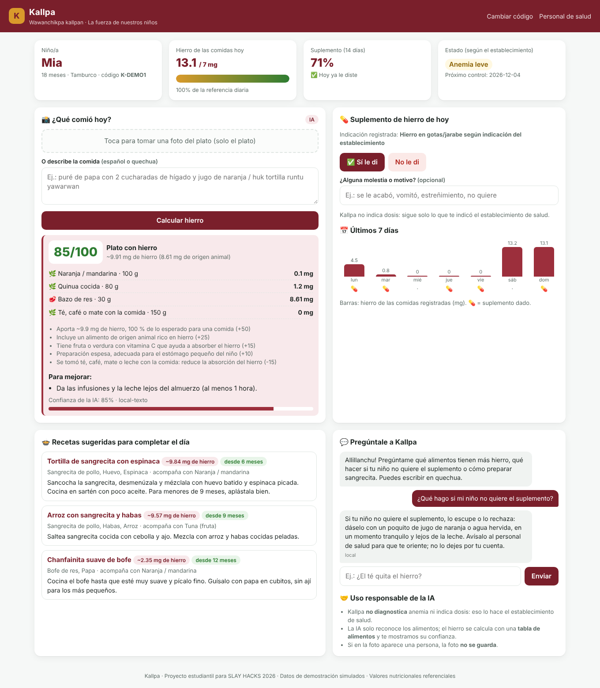
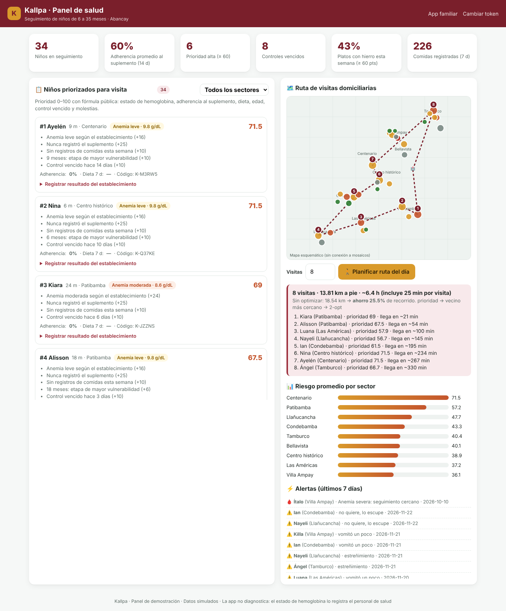

# Kallpa 🩸 — IA contra la anemia infantil en Abancay

> *Kallpa* significa **fuerza** en quechua. *Wawanchikpa kallpan*: la fuerza de nuestros niños.

**Kallpa** acompaña a las familias de Abancay (Apurímac, Perú) para prevenir y superar la anemia infantil, y ayuda al personal de salud a decidir **a quién visitar primero**.

- La **familia** toma una foto del plato del niño (o lo describe en español o quechua). La IA reconoce los alimentos y Kallpa calcula el hierro con una tabla de alimentos, da un puntaje "Plato con hierro" y consejos concretos, recuerda el suplemento y sugiere recetas locales.
- El **establecimiento de salud** ve a los niños priorizados por riesgo con razones explicables: estado de hemoglobina, adherencia al suplemento, dieta, edad, control vencido y molestias. Recibe alertas y planifica la ruta de visitas domiciliarias.

Proyecto para **SLAY HACKS 2026** y el curso de **Arquitectura de Software**.




---

## El problema

- En Apurímac, la anemia en niños de 6 a 35 meses llegó a **55.8 % en 2023**, con tendencia creciente (MIDIS, con datos del INEI/ENDES). Es una de las prevalencias más altas del país.
- La anemia en los primeros años afecta el desarrollo cerebral, el aprendizaje y las defensas, y el daño puede ser permanente.
- Las causas cotidianas son conocidas: poco alimento de origen animal rico en hierro, sopas en lugar de comidas espesas, té o mate con las comidas y **abandono del suplemento de hierro** (por olvido, molestias o falta de seguimiento).
- El personal de salud tiene muchos niños por sector y poca información entre controles: se entera del abandono semanas después.

## La solución

| Para la familia (app web en el celular) | Para el establecimiento de salud (panel) |
|---|---|
| Foto o descripción del plato → **hierro estimado** y puntaje con razones | Niños **priorizados de 0 a 100** con razones |
| Consejos concretos ("agrega 2 cucharadas de sangrecita", "el té, lejos del almuerzo") | **Alertas**: molestias con el suplemento, 3 días sin darlo, anemia severa |
| **Registro diario del suplemento** + reporte de molestias | **Ruta óptima de visitas domiciliarias** (~25 % menos recorrido en la demo) |
| **Recetas locales** que completan el hierro que falta hoy | Registro del resultado de hemoglobina y del esquema indicado |
| **Asistente** en español o quechua con información validada | Riesgo promedio por sector; tendencia de adherencia por niño |

## Cómo usa la IA

| Componente | Técnica | Para qué |
|---|---|---|
| Reconocimiento de alimentos en la foto | **LLM multimodal** (Claude u otro compatible con OpenAI: GPT-4o-mini, Gemini…) restringido a un **catálogo cerrado** de 42 alimentos andinos, con salida JSON validada | Identificar alimentos y gramos servidos al niño, la consistencia (sopa o espesa) y si aparecen personas en la foto |
| Cálculo nutricional | **Determinista** en el dominio con una tabla de alimentos | El LLM **nunca** inventa cifras de hierro |
| Respaldo sin internet | Extractor local de alimentos y cantidades en español y quechua (sinónimos, sufijos como *-wan* o *-ta*, "2 cucharadas") | Que la app funcione sin API key, sin saldo o sin señal |
| Asistente | LLM con **RAG** sobre una base de conocimiento validada; respaldo con **BM25** | Respuestas en español o quechua; nunca da dosis ni diagnósticos |
| Priorización | **Puntaje explicable** con pesos públicos | Decidir visitas con criterio auditable |
| Tendencia de adherencia | Suavizado exponencial | Detectar el abandono progresivo antes de que ocurra |
| Recomendador | Utilidad: hierro que falta − repetición + fuente animal, filtrado por edad | Receta local adecuada para hoy |
| Ruteo | Vecino más cercano + **2-opt** | Menos horas caminando entre visitas |

**Uso responsable:** Kallpa **no diagnostica ni indica dosis** (eso lo hace el establecimiento). La IA solo percibe y el cálculo es trazable. Se muestra la confianza. Las fotos con personas **no se guardan** y el resto se re-codifica sin EXIF. Se usa un código familiar (sin DNI) con consentimiento informado. Ver [`docs/ia-responsable.md`](docs/ia-responsable.md).

## Arquitectura

Monolito modular con **arquitectura hexagonal (puertos y adaptadores)**:

```
app/
├── domain/          # Entidades y servicios puros: nutrición, riesgo, recomendador, ruteo
├── application/     # Casos de uso + puertos (interfaces)
├── infrastructure/  # IA (Claude / OpenAI-compatible / local), SQLite y PostgreSQL, catálogo, fotos, reloj
├── api/             # Adaptador HTTP (Flask) + DTOs
└── container.py     # Raíz de composición
web/                 # App familiar y panel (HTML/JS sin build)
data/                # Catálogo de alimentos, recetas, base de conocimiento, sectores
tests/               # 42 pruebas
docs/                # Arquitectura (C4), 7 ADRs, IA responsable, Devpost, guion de video
```

Documento completo: [`docs/arquitectura.md`](docs/arquitectura.md).

## Ejecutar en local

Requisitos: **Python 3.11+**.

```bash
git clone https://github.com/Carlos22-I/Kallpa.git && cd Kallpa
python -m venv .venv
# Windows: .venv\Scripts\activate   |   Linux/Mac: source .venv/bin/activate
pip install -r requirements.txt
cp .env.example .env              # opcional: API key para la visión con IA
python -m app.seed --reset        # datos simulados; imprime un código familiar de prueba
python wsgi.py                    # http://localhost:5000
```

- App familiar: `http://localhost:5000/?codigo=K-DEMO1`
- Panel de salud: `http://localhost:5000/panel` (en local, sin `PANEL_TOKEN` en `.env`, el token es `demo-abancay`)
- Pruebas: `pip install -r requirements-dev.txt && pytest -q`

Sin API key funciona la descripción por texto (modelo local). Con API key se activa el análisis de **fotos**.

**IA recomendada:** Claude Haiku 5.5 (principal, ≈ US$ 0.0003 por foto) + Gemini 3.1 Flash-Lite en su capa gratuita (respaldo) + modelo local. Opciones, costos y pasos en [`docs/ia-apis.md`](docs/ia-apis.md). Para probar las claves: `python -m app.probar_ia --foto plato.jpg`.

| Variable | Ejemplo |
|---|---|
| `ANTHROPIC_API_KEY` / `ANTHROPIC_MODEL` | `sk-ant-...` / `claude-haiku-5-5` |
| `OPENAI_API_KEY` / `OPENAI_BASE_URL` / `OPENAI_MODEL` | clave de AI Studio / `https://generativelanguage.googleapis.com/v1beta/openai/` / `gemini-3.1-flash-lite` |
| `OPENAI_REASONING_EFFORT` | `low` (Gemini 3) |
| `PANEL_TOKEN` | cámbialo en producción (la app avisa en el log si sigue siendo el de demo) |
| `TRUSTED_PROXIES` | `1` detrás de Render o Nginx; `0` en local |
| `FAILED_LOOKUPS_PER_HOUR` | `20`: códigos o tokens equivocados por IP antes de bloquear |

## API

| Método | Ruta | Descripción |
|---|---|---|
| `POST` | `/api/familias` | Registro con consentimiento → código familiar |
| `GET` | `/api/familias/{codigo}` | Resumen: hierro de hoy, semana, adherencia, recetas |
| `POST` | `/api/familias/{codigo}/comidas` | multipart: `foto` y/o `descripcion` → análisis |
| `POST` | `/api/familias/{codigo}/suplemento` | `{ "dado": true, "nota": "..." }` |
| `POST` | `/api/asistente` | `{ "pregunta": "...", "codigo": "..." }` |
| `GET` | `/api/panel/ninos` | Priorización con razones *(header `X-Panel-Token`)* |
| `PATCH` | `/api/panel/ninos/{id}` | Registro clínico del establecimiento |
| `GET` | `/api/panel/alertas` | Alertas de los últimos 7 días |
| `POST` | `/api/panel/visitas` | Ruta de visitas optimizada |
| `GET` | `/api/panel/resumen` | KPIs |

## Limitaciones (somos honestos)

- **Datos simulados** y coordenadas aproximadas.
- Los **valores de hierro son referenciales**: deben verificarse con la Tabla Peruana de Composición de Alimentos (CENAN-INS) y con nutricionistas antes de un piloto.
- La estimación de gramos desde una foto es aproximada; por eso la app muestra la confianza y orienta en lugar de diagnosticar.

## Equipo

- Carlos Daniel Huachallanqui Olivera
- Maria Magdalena Villegas Huamani
- Yaison Terry Huamani Carhuaricra

Licencia MIT.
