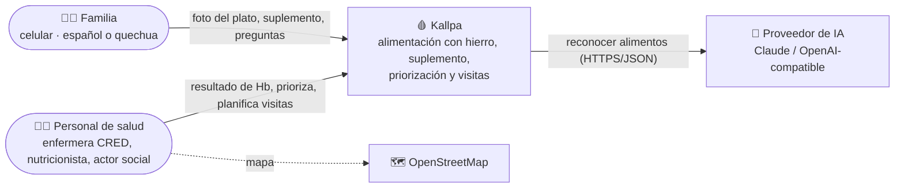
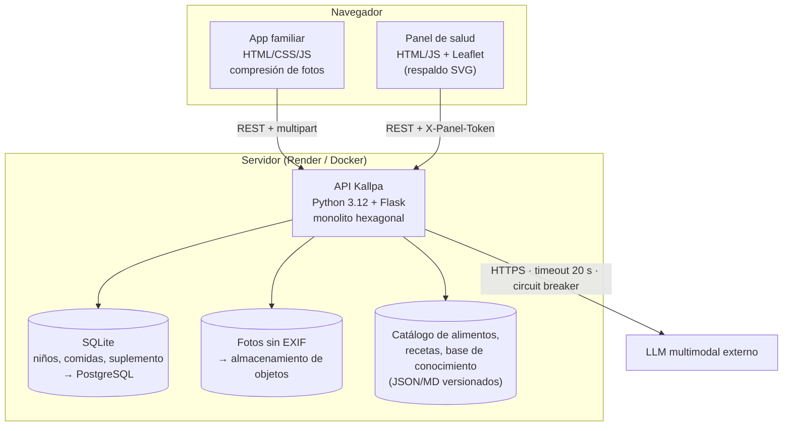
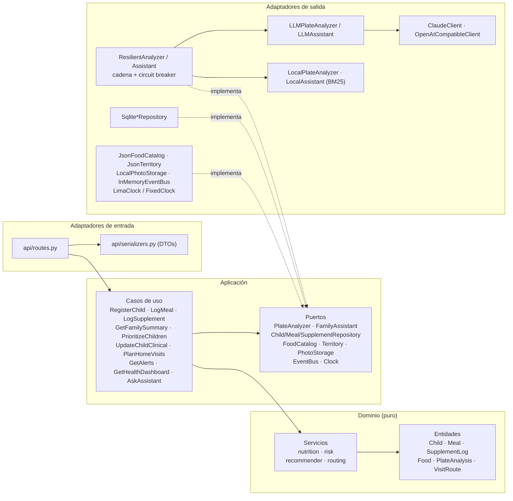
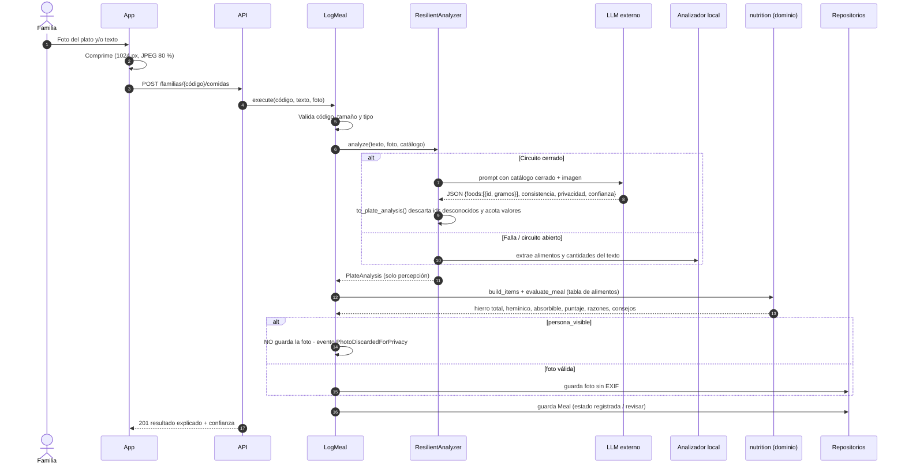
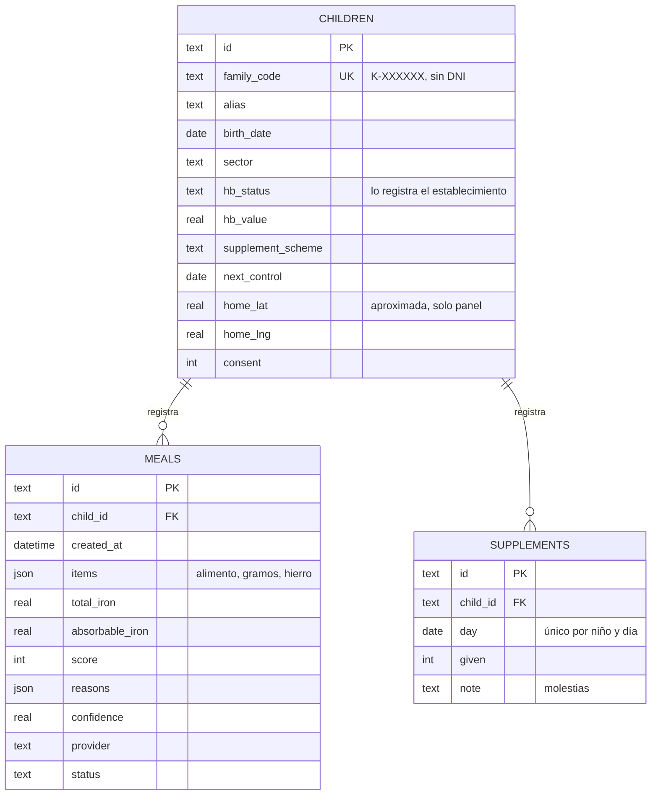
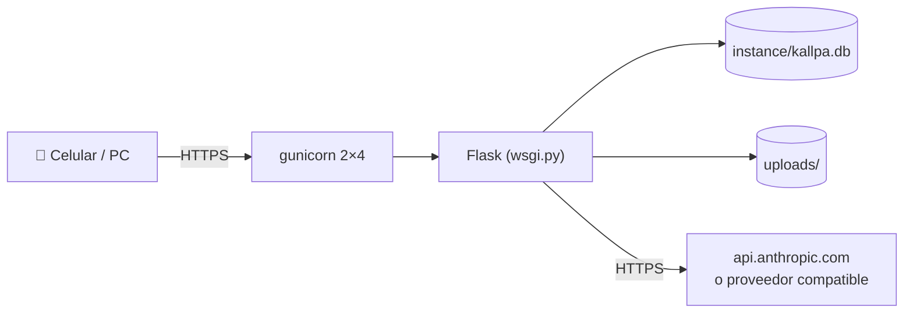

# Documento de Arquitectura de Software — Kallpa

**Curso:** Arquitectura de Software · **Proyecto:** Kallpa (SLAY HACKS 2026) · **Versión:** 1.0 · Noviembre 2026

---

## 1. Introducción

### 1.1 Propósito
Este documento describe la arquitectura de **Kallpa**, un sistema con inteligencia artificial que acompaña a las familias de Abancay en la alimentación rica en hierro y la adherencia al suplemento, y que ayuda al personal de salud a priorizar el seguimiento de niños con anemia o en riesgo de tenerla.

### 1.2 Contexto
En Apurímac la anemia en niños de 6 a 35 meses alcanzó **55.8 % en 2023** (MIDIS, con datos del INEI). Entre controles, el establecimiento de salud no sabe si la familia da el suplemento ni qué come el niño, y se entera del abandono tarde.

### 1.3 Alcance del prototipo
| Incluido | Evolución |
|---|---|
| App familiar: foto o texto del plato, hierro estimado, suplemento, recetas, asistente | Canal de WhatsApp y recordatorios por SMS |
| Panel de salud: priorización, alertas, registro clínico, ruta de visitas | Integración con HIS-MINSA / SIEN y padrón nominal |
| IA multimodal con respaldo local y circuit breaker | Modelo de visión propio entrenado con platos andinos |
| Seguridad básica (token de panel, código familiar, rate limit) | Cuentas con roles (OIDC), cifrado en reposo |

---

## 2. Stakeholders

| Stakeholder | Necesidad | Preocupación arquitectónica |
|---|---|---|
| Madre, padre o cuidador | Saber si su niño come suficiente hierro; recordar el suplemento | Usabilidad, quechua, celular de gama baja, privacidad |
| Personal de salud (enfermera CRED, nutricionista) | Saber a quién visitar primero y por qué | Explicabilidad, exactitud, rapidez |
| Actor social / agente comunitario | Ruta de visitas del día | Rendimiento, uso sin conexión |
| Jefe del establecimiento / DIRESA | Indicadores de adherencia y riesgo por sector | Auditabilidad, disponibilidad de datos |
| Equipo de desarrollo | Cambiar de modelo de IA o de base de datos sin reescribir | Modificabilidad, testeabilidad |

---

## 3. Drivers arquitectónicos

### 3.1 Requisitos funcionales clave
- **RF1** Registro del niño con consentimiento y código familiar (sin DNI).
- **RF2** Registrar una comida por foto o texto (español o quechua) y estimar el hierro y su calidad.
- **RF3** Registrar diariamente el suplemento y las molestias.
- **RF4** Recomendar recetas locales según la edad y el hierro que falta hoy.
- **RF5** Priorizar niños con razones explicables.
- **RF6** Generar alertas accionables.
- **RF7** Planificar la ruta de visitas domiciliarias.
- **RF8** Responder dudas con información validada, sin dar dosis ni diagnósticos.

### 3.2 Atributos de calidad (escenarios)

| ID | Atributo | Escenario | Medida | Táctica |
|---|---|---|---|---|
| QA1 | **Seguridad del paciente (IA responsable)** | Un LLM "alucina" que la sopa de fideos tiene 10 mg de hierro | 0 cifras nutricionales generadas por el LLM | El LLM solo elige ids de un catálogo cerrado; el cálculo es determinista (ADR-004) |
| QA2 | **Disponibilidad** | La API de IA cae o se queda sin saldo | 100 % de comidas registrables por texto; ≤ 3 llamadas fallidas antes de cortar | Circuit breaker + respaldo local (ADR-002) |
| QA3 | **Privacidad** | Una mamá fotografía el plato con su bebé en la imagen | Foto no almacenada; 0 metadatos EXIF en las fotos guardadas | Flag `persona_visible`, re-codificación de la imagen, código familiar (ADR-006) |
| QA4 | **Explicabilidad** | La enfermera pregunta por qué Ayelén está primera | Cada niño muestra entre 2 y 6 razones con su peso | Fórmula pública (ADR-005) |
| QA5 | **Modificabilidad** | Pasar de Claude a Gemini | 0 cambios en dominio y casos de uso | Puertos y adaptadores, `LLMClient` |
| QA6 | **Usabilidad e inclusión** | Una abuela quechuahablante registra el almuerzo | ≤ 3 interacciones; entiende el resultado | Texto en quechua con sufijos, iconos, consejos concretos |
| QA7 | **Rendimiento** | Foto de 8 MB desde 3G | Subida < 250 KB; respuesta < 5 s con IA externa y < 100 ms local | Compresión en el cliente (1024 px), timeout de 20 s |
| QA8 | **Testeabilidad** | Cambio en la fórmula de riesgo | Regresión detectada en < 1 s sin red | Dominio puro, reloj inyectable (`FixedClock`), clientes LLM falsos |

### 3.3 Restricciones
- Plazo de un mes y presupuesto cero; despliegue en un plan gratuito.
- **Restricción ética y normativa:** la app no reemplaza al personal de salud ni la norma técnica del MINSA; no diagnostica ni dosifica.
- Fechas en hora de Perú (UTC-5), no del servidor.

---

## 4. Estilo arquitectónico
**Monolito modular + arquitectura hexagonal**, con eventos de dominio y API REST. Ver **ADR-001**.

---

## 5. Vistas (modelo C4)

### 5.1 Contexto

### 5.2 Contenedores

### 5.3 Componentes

### 5.4 Vista dinámica — "Registrar una comida"

### 5.5 Vista de datos

La prioridad y las alertas **se calculan al consultar**: dependen de la fecha actual y nunca quedan desactualizadas.

### 5.6 Vista de despliegue

---

## 6. Patrones y principios

| Patrón | Dónde | Para qué |
|---|---|---|
| Puertos y adaptadores | `application/ports.py`, `infrastructure/*` | Aislar el negocio de la tecnología |
| Raíz de composición / DI | `container.py` | Un solo lugar elige las implementaciones |
| Strategy + Bridge | `PlateAnalyzer` × `LLMClient` | Combinar cualquier modelo con cualquier proveedor |
| Cadena de responsabilidad + Circuit Breaker | `ResilientAnalyzer` | Tolerancia a fallos de la IA |
| Repository | `Sqlite*Repository` | Persistencia intercambiable |
| Application Factory | `create_app(cfg, clock)` | Instancias configurables para pruebas |
| DTO | `api/serializers.py` | La vista familiar no expone coordenadas |
| Observer / eventos de dominio | `domain/events.py` | Alertas y notificaciones desacopladas |
| Inyección de reloj (`Clock`) | `LimaClock`, `FixedClock` | Fechas de Perú y pruebas deterministas |
| Adapter (frontend) | `LeafletMap` / `SvgMap` | El mapa funciona aunque no carguen los mosaicos |
| Value Object | `GeoPoint`, `PlateAnalysis`, `DetectedFood` | Inmutabilidad y validación |

SOLID: **S** casos de uso pequeños; **O** proveedor nuevo = clase nueva; **L** cualquier `PlateAnalyzer` es sustituible; **I** puertos específicos; **D** los casos de uso dependen de abstracciones.

---

## 7. Diseño de la IA

### 7.1 Percepción con catálogo cerrado
El prompt incluye los 42 ids del catálogo. El LLM devuelve `{id, gramos}`, la consistencia y flags de privacidad. `to_plate_analysis()` descarta ids desconocidos, acota los gramos (1–400) y la confianza (0–1), y filtra los flags. **El LLM no calcula hierro.**

### 7.2 Cálculo nutricional (dominio)
- Hierro por alimento = hierro por 100 g × gramos / 100 (tabla en `data/alimentos.json`).
- Hierro absorbible estimado (educativo): hemínico × 0.25 + no hemínico × 0.05 × (1.6 con vitamina C) × (0.6 con té, café o leche).
- **Puntaje "Plato con hierro" (0–100):** cobertura de un tercio de la referencia diaria (50), alimento de origen animal rico en hierro (25, o 12 si es animal común), vitamina C (15), preparación espesa (10), menos 15 por inhibidores.
- Referencia diaria (IOM): 11 mg de 7 a 12 meses; 7 mg de 1 a 3 años.

### 7.3 Respaldo local
Coincidencia de sinónimos normalizados (sin tildes, sinónimos más largos primero), tolerancia a sufijos quechuas (*-wan, -ta, -pi, -cha, -kuna, -manta, -lla*) y cantidades ("2 cucharadas", "media presa", "iskay").

### 7.4 Priorización (0–100)
| Factor | Peso | Cálculo |
|---|---|---|
| Hemoglobina (registrada por el establecimiento) | 30 | severa 1.0 · moderada 0.8 · leve 0.55 · sin dato 0.4 · sin anemia 0 |
| Adherencia al suplemento (14 d) | 25 | 1 − adherencia; máximo si hay ≥ 3 días sin registro |
| Dieta (7 d) | 20 | 1 − puntaje promedio/100; 0.5 si no hay registros |
| Edad | 10 | 6–11 meses = 1.0; 12–23 = 0.6 |
| Control vencido | 10 | sí/no |
| Molestias reportadas (7 d) | 5 | sí/no |

### 7.5 Asistente
RAG: la base de conocimiento validada va en el contexto; el prompt prohíbe dosis y diagnósticos y obliga a derivar ante signos de alarma. El respaldo usa BM25 sobre los mismos pasajes.

---

## 8. Seguridad y privacidad
- Código familiar aleatorio (`secrets`), sin DNI ni nombre completo; consentimiento obligatorio.
- La vista familiar no expone la ubicación; las coordenadas aproximadas solo se ven en el panel.
- Fotos: re-codificadas sin EXIF; descartadas si aparece una persona.
- Panel con token (`hmac.compare_digest`); evolución a OIDC con roles.
- Rate limit por IP; límite de carga; lista blanca de MIME; escape de HTML en el frontend.
- Ley N.° 29733 de Protección de Datos Personales: los datos de salud son sensibles; en un piloto se requieren un convenio con la DIRESA, cifrado y política de retención.

---

## 9. Pruebas
| Archivo | Cobertura |
|---|---|
| `tests/test_domain.py` | Edad y referencia, cálculo de hierro, puntaje, inhibidores, adherencia, prioridad, tendencia, ruta, recomendador, fecha de Lima |
| `tests/test_ai.py` | Extractor local (incluido el quechua), validación de la salida del LLM, adaptador con cliente falso, fallback y circuit breaker, el asistente no da dosis |
| `tests/test_api.py` | Consentimiento, flujo familiar, EXIF, alertas, registro clínico, token, visitas |

`pytest -q` → **42 pruebas, < 1 s, sin red**. CI en GitHub Actions.

---

## 10. ADRs
| ADR | Decisión |
|---|---|
| [001](adr/001-monolito-modular-hexagonal.md) | Monolito modular hexagonal |
| [002](adr/002-ia-multiproveedor-con-respaldo-local.md) | IA multiproveedor con respaldo local y circuit breaker |
| [003](adr/003-sqlite-a-postgresql.md) | SQLite en el prototipo, PostgreSQL en producción |
| [004](adr/004-llm-percibe-dominio-calcula.md) | El LLM percibe, el dominio calcula (catálogo cerrado) |
| [005](adr/005-priorizacion-explicable.md) | Priorización con fórmula explicable |
| [006](adr/006-privacidad-y-no-diagnostico.md) | Privacidad por diseño y "no diagnosticar ni dosificar" |
| [007](adr/007-frontend-sin-build.md) | Frontend sin build con mapa resiliente |

## 11. Riesgos
| Riesgo | Mitigación |
|---|---|
| Estimación de gramos imprecisa | Mostrar la confianza; la app orienta, no prescribe; la familia puede corregir por texto |
| Valores de la tabla desactualizados | Archivo versionado y validable por nutricionistas (TPCA CENAN-INS) |
| Brecha digital (familias sin smartphone) | Uso asistido por el actor social durante la visita; evolución a WhatsApp |
| Mal uso de datos de salud | Minimización, consentimiento, convenio y roles |
| Dependencia de un proveedor de IA | Multiproveedor + respaldo local |

## 12. Hoja de ruta
1. Piloto con un establecimiento de la Red de Salud Abancay y validación de la tabla con nutricionistas.
2. WhatsApp como nuevo adaptador de entrada (fotos y recordatorios).
3. Integración con el padrón nominal y el registro HIS.
4. Modelo de visión propio con fotos de platos andinos validadas.
5. Evaluación de impacto: adherencia y hemoglobina a 3 y 6 meses frente a un grupo de comparación.
